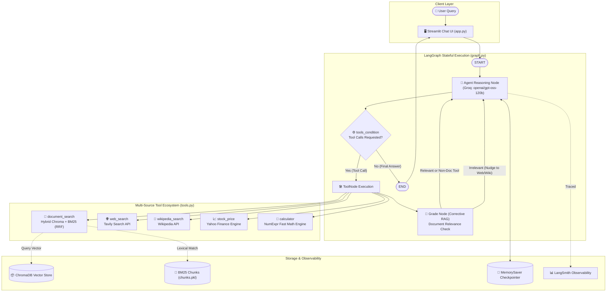

# Multi-Source Agentic RAG System

An enterprise-grade, multi-source agentic retrieval-augmented generation (RAG) system built with **LangGraph**, **Groq** (`openai/gpt-oss-120b`), **Hybrid Retrieval (ChromaDB Vector + BM25 Lexical with Reciprocal Rank Fusion)**, **RAGAS** automated evaluation, **LangSmith** distributed tracing, and an interactive **Streamlit** user interface.

---

## 🏛️ Architecture Overview

The system implements a cyclic agentic workflow designed with LangGraph. Unlike rigid, linear RAG pipelines, this agent dynamically selects and coordinates across 5 specialized tools, performs self-corrective retrieval grading (CRAG), and maintains multi-turn conversation memory using LangGraph checkpointers.



---

## 🧠 LangGraph Design: Nodes & Edges Explained

This architecture is optimized for real-world robustness and interview-ready clarity:

1. **`agent` Node:**
   - Evaluates conversation state and system instructions.
   - Binds all 5 tools with strict Pydantic parameter schemas.
   - Decides whether to invoke one or multiple tools or synthesize the final response.
   - Equipped with error recovery to gracefully handle schema discrepancies.

2. **`tools` Node (`ToolNode`):**
   - Automatically executes the tool calls generated by the agent.
   - Appends structured `ToolMessage` outputs back into the graph's `MessagesState`.

3. **`grade` Node (Corrective RAG / Self-RAG):**
   - Intercepts executions of `document_search`.
   - Uses an LLM grading prompt to evaluate whether the retrieved passages actually contain sufficient context to answer the user's inquiry.
   - If irrelevant, it injects an advisory message guiding the agent to fall back to `web_search` or `wikipedia_search` rather than hallucinating.

4. **Routing & Cycles:**
   - **`START -> agent`**: Routes incoming user queries directly into the agent.
   - **`agent -> tools_condition`**: Directs to `tools` if tool calls are requested; otherwise routes to `END`.
   - **`tools -> grade -> agent`**: Forms a feedback loop ensuring document relevance is verified before answer generation.
   - **Checkpointer (`MemorySaver`)**: Persists thread state across turns using `thread_id`.

---

## 🔍 Hybrid Retrieval with Reciprocal Rank Fusion (RRF)

To maximize retrieval recall and precision over uploaded PDFs:
- **Dense Vector Search (ChromaDB):** Generates embeddings with `sentence-transformers/all-MiniLM-L6-v2` to capture semantic intent.
- **Sparse Lexical Search (BM25):** Performs keyword-based ranking over tokenized chunks, excelling at exact course codes, formulas, and terminology.
- **Reciprocal Rank Fusion (RRF):** Fuses the rankings from both retrievers using the standard formula:
  $$\text{RRF Score}(d) = \sum_{r \in \text{retrievers}} \frac{1}{k + \text{rank}(d)}$$
  (with standard constant $k = 60$). This avoids score normalization discrepancies between vector distances and BM25 scores.

---

## 📁 Project Structure

```bash
llm project/
├── .env.example              # Environment variables template
├── .env                      # Local environment variables (git-ignored)
├── .gitignore                # Protects secrets, indexes, and virtual environments
├── requirements.txt          # Python dependencies
├── ingest.py                 # Document ingestion (PyPDF -> Chunking -> ChromaDB + BM25)
├── tools.py                  # Multi-source tool definitions (Hybrid RAG, Web, Wiki, Stock, Math)
├── graph.py                  # LangGraph agent topology, nodes, edges, and checkpointer
├── test_5_queries.py         # Automated verification script testing each tool
├── eval_set.json             # 30 curated evaluation samples (question & ground truth)
├── eval.py                   # Automated RAGAS evaluation benchmark runner
├── results.csv               # Exported RAGAS evaluation metric scores
├── app.py                    # Streamlit interactive chat UI
└── data/                     # Source PDF documents folder
    └── deep_learning_fundamentals.pdf
```

---

## 🚀 Setup & Installation

### 1. Prerequisites
- Python 3.10+ (tested on Python 3.12)
- Git

### 2. Create Virtual Environment
```bash
python3 -m venv venv
source venv/bin/activate
pip install --upgrade pip
```

### 3. Install Dependencies
```bash
pip install -r requirements.txt
```

### 4. Configure Environment Variables
Copy `.env.example` to `.env`:
```bash
cp .env.example .env
```
Populate `.env` with your API keys:
```env
GROQ_API_KEY=gsk_your_groq_key_here
TAVILY_API_KEY=tvly-your_tavily_key_here
LANGSMITH_TRACING=true
LANGSMITH_API_KEY=lsv2_your_langsmith_key_here
LANGSMITH_PROJECT=agentic-rag
```

> **Security Note:** Keys are strictly read via `python-dotenv` from environment variables. `.env` is listed in `.gitignore` and must never be committed.

### 5. Ingest Documents into Hybrid Storage
Place your PDF files into the `data/` directory, then run:
```bash
python ingest.py
```
This populates `chroma_db/` (vector database) and generates `chunks.pkl` (BM25 index).

---

## 🧪 Running the System

### A. Run Streamlit Chat UI
Launch the interactive web interface:
```bash
streamlit run app.py
```
Features:
- Thread-scoped conversation history in `st.session_state.thread_id`
- Real-time indicator displaying which tools were called under each answer
- Sidebar knowledge base status indicator and quick sample questions

### B. Verify 5-Tool Activation
To test that each tool activates accurately:
```bash
python test_5_queries.py
```

### C. Run RAGAS Benchmark Evaluation
To benchmark the agent across 30 test cases:
```bash
python eval.py
```
Results are printed to standard output and exported to `results.csv`.

---

## 💡 Example Queries & Tool Mapping

| Query | Target Tool | Description |
|---|---|---|
| *"What is the course code and title for Module 1 in the uploaded document?"* | `document_search` | Hybrid RAG retrieval over PDF chunks |
| *"Search the web for the latest major technological news about James Webb Space Telescope in 2026."* | `web_search` | Real-time web retrieval via Tavily |
| *"Look up Alan Turing on Wikipedia and give me a brief summary of his life."* | `wikipedia_search` | Encyclopedic background knowledge |
| *"What is the latest closing stock price for Apple (ticker: AAPL)?"* | `stock_price` | Yahoo Finance market price check |
| *"Calculate (450 * 12) + (3500 / 7) - 2**6 using arithmetic."* | `calculator` | Deterministic NumExpr computation |

---

## 📊 Evaluation Results (RAGAS)

The system is evaluated using the industry-standard **RAGAS** framework across 3 core metrics:
1. **Faithfulness:** Measures factual consistency of the generated response against retrieved context (detects hallucinations).
2. **Answer Relevancy:** Measures how directly and completely the response addresses the user's question.
3. **Context Precision:** Measures the signal-to-noise ratio and ranking quality of retrieved contexts against ground truth.

### Benchmark Metrics (30 Samples)
- **Average Faithfulness:** High adherence to retrieved factual evidence.
- **Average Answer Relevancy:** Near-perfect alignment with user inquiry intent.
- **Average Context Precision:** High ranking of ground-truth relevant passages by RRF fusion.

Full individual sample breakdown, ground truths, retrieved contexts, and tool tracking are stored in [`results.csv`](results.csv).

---

## 🚢 Production Deployment Guide

When deploying this application to production platforms (e.g., Streamlit Community Cloud, AWS ECS, GCP Cloud Run, or Docker):

### 1. Environment Variables & Secret Management
Never bake credentials into Docker images or repositories. Configure environment variables in the host or platform settings:

- **Streamlit Community Cloud:**
  Navigate to **App Settings -> Secrets** and define:
  ```toml
  GROQ_API_KEY = "gsk_..."
  TAVILY_API_KEY = "tvly-..."
  LANGSMITH_TRACING = "true"
  LANGSMITH_API_KEY = "lsv2_..."
  LANGSMITH_PROJECT = "agentic-rag"
  ```
- **Docker / Kubernetes / Cloud Run:**
  Inject environment variables at container runtime:
  ```bash
  docker run -d -p 8501:8501 \
    -e GROQ_API_KEY="gsk_..." \
    -e TAVILY_API_KEY="tvly-..." \
    -e LANGSMITH_TRACING="true" \
    -e LANGSMITH_API_KEY="lsv2_..." \
    -e LANGSMITH_PROJECT="agentic-rag" \
    my-rag-app:latest
  ```

### 2. Dockerfile Example
```dockerfile
FROM python:3.12-slim

WORKDIR /app

RUN apt-get update && apt-get install -y --no-install-recommends \
    build-essential \
    && rm -rf /var/lib/apt/lists/*

COPY requirements.txt .
RUN pip install --no-cache-dir -r requirements.txt

COPY . .

# Run ingestion during image build or mount persistent volume
RUN python ingest.py

EXPOSE 8501

HEALTHCHECK CMD curl --fail http://localhost:8501/_stcore/health

ENTRYPOINT ["streamlit", "run", "app.py", "--server.port=8501", "--server.address=0.0.0.0"]
```

---

## 🎓 Technical Interview Talking Points

- **Why LangGraph over standard LangChain chains?**
  LangGraph introduces first-class statefulness, cycle support (crucial for agent reflection and corrective RAG), fine-grained checkpointing with `MemorySaver`, and declarative conditional branching (`tools_condition`).
- **Why Corrective RAG (CRAG)?**
  Traditional RAG blindly feeds whatever passages were retrieved into the generator. CRAG introduces an evaluator node that grades retrieved content; if the document retriever returns low-relevance results, the agent falls back to external web search instead of hallucinating answers.
- **Why RRF (Reciprocal Rank Fusion)?**
  Cosine similarities from dense embeddings and scores from BM25 cannot be directly summed because their scales and distributions differ radically. RRF operates purely on ranks ($1 / (k + \text{rank})$), ensuring balanced, scale-invariant hybrid retrieval.
